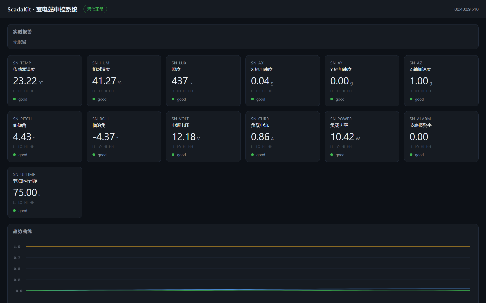

# microsense

**单片机上的多功能传感器节点** —— 用 MicroPython 写，一块 ESP32/Pico 就能采集温湿度、照度、
姿态和电压电流，并直接以 **Modbus** 对外供数。

关键点：**没有硬件也能跑完整测试和演示**。所有驱动都通过一层总线抽象访问 I2C/ADC，仓库自带
寄存器级的假设备，所以 `pytest` 在 CI 里就能验证全部逻辑；`python -m microsense simulate`
在笔记本上就能看到这个节点"活着"。

[](https://github.com/lcymxm/microsense/actions/workflows/ci.yml)
[](LICENSE)

```
┌──────────────────────────┐
│  单片机 (MicroPython)      │     I2C: SHT31 / BH1750 / MPU6050
│                          │     ADC: 分压 + 分流
│  bus → drivers → filters │
│        ↓                 │
│      node (质量码/报警)    │
│        ↓                 │
│   Modbus TCP / JSON 行    │
└────────────┬─────────────┘
             │ Modbus
             ▼
   ScadaKit 上位机 (C++)    ← 详见 examples/scadakit.tags
```

上面这条链是真的跑通的，不是示意图：



左边那些点位（`SN-TEMP` 传感器温度 23.22 °C、`SN-ROLL` 横滚角、`SN-VOLT` 电源电压 12.18 V、
`SN-CURR` 负载电流 0.86 A）全部来自一个正在运行的 Python 传感器节点，通过 Modbus TCP 被
[C++ 写的 SCADA 网关](https://github.com/lcymxm/scadakit) 读走并显示。

## 为什么写这个

自动化/电气方向做的现场设备，最后几乎都要接进上位机。但嵌入式项目常见两个坑：

1. **只有硬件才能验证** —— 代码提交上去，谁也没法在 CI 里跑一遍。
2. **数值没有质量** —— 通信断了，画面还显示最后一个数，看起来一切正常。

这个项目针对这两点做了设计：驱动全部走总线抽象，假设备在寄存器层面复刻真实芯片（包括 CRC、
配置寄存器、量程换算），所以**逻辑是可以在 CI 里测的**；节点对外发布的每个值都带质量码
（good / stale / fault），通信断了、循环卡住了、设备挂了，三种情况都能被区分出来。

## 能做什么

| 模块 | 说明 |
|------|------|
| 总线抽象 | `I2C` / `ADC` 接口 + 真实实现（延迟导入 `machine`）+ 寄存器级假实现，同一份驱动代码两边都跑 |
| SHT31 | 温湿度，含 **CRC-8 校验**，CRC 错直接抛异常而不是给一个静默错误的读数 |
| BH1750 | 照度（lux），支持连续/单次测量与休眠 |
| MPU6050 | 加速度 ±2/4/8/16 g、陀螺 ±250/500/1000/2000 dps，量程与换算严格对应 |
| ADC 通道 | 分压比、分流电阻、放大倍数、过采样，配合两点线性标定 |
| 滤波器 | 滑动平均、中值、指数、**互补滤波**（加速度计 + 陀螺算俯仰/横滚） |
| 标定 | 两点线性标定，JSON 存取，掉电重载 |
| 节点 | 传感器注册、周期调度、质量码、阈值报警（带回差）、事件记录 |
| Modbus | CRC-16、RTU 帧、MBAP 帧、寄存器映射、TCP 服务器 |
| 行协议 | JSON / CSV / 终端表格，供串口或调试用 |

## 快速开始

不需要单片机，不需要装硬件：

```bash
pip install pytest
python -m pytest -q            # 106 条测试

python -m microsense dump      # 读一次全部点位
python -m microsense simulate  # 连续运行，假设备在动
```

`dump` 的输出：

```
point                        value  unit   quality alarm
--------------------------------------------------------
sht31.temperature           22.001  degC   good    normal
sht31.humidity              45.000  %      good    normal
bh1750.lux                 320.000  lux    good    normal
imu.ax                       0.020  g      good    normal
imu.ay                       0.010  g      good    normal
imu.az                       1.000  g      good    normal
imu.pitch                   -1.147  deg    good    normal
imu.roll                     0.573  deg    good    normal
adc.voltage                 12.097  V      good    normal
adc.current                  0.850  A      good    normal
adc.power                   10.278  W      good    normal
```

### 接上位机

```bash
# 终端 1：节点，同时开 Modbus TCP
python -m microsense run --modbus-port 1502

# 终端 2：用 ScadaKit 读它（需要先编译 scadakit）
scadakit probe --tags examples/scadakit.tags --port 1502
scadakit run   --tags examples/scadakit.tags --port 1502   # 带网页组态画面
```

`examples/scadakit.tags` 是配套的点表，直接可用。

## 点位与寄存器表

每个点位占一个 16 位寄存器，顺序固定（见 `microsense/cli.py` 的 `POINT_ORDER`）：

| 寄存器 | 点位 | 单位 | 缩放 | 说明 |
|-------:|------|------|------|------|
| 0 | `sht31.temperature` | °C | ×100 | int16，可负 |
| 1 | `sht31.humidity` | % | ×100 | |
| 2 | `bh1750.lux` | lx | ×1 | uint16 |
| 3 | `imu.ax` | g | ×1000 | |
| 4 | `imu.ay` | g | ×1000 | |
| 5 | `imu.az` | g | ×1000 | |
| 6 | `imu.pitch` | ° | ×100 | 互补滤波融合值 |
| 7 | `imu.roll` | ° | ×100 | |
| 8 | `adc.voltage` | V | ×100 | uint16 |
| 9 | `adc.current` | A | ×1000 | uint16 |
| 10 | `adc.power` | W | ×100 | 电压 × 电流 |
| 11 | 报警字 | — | — | 第 i 位 = 第 i 个点位正在报警 |
| 12–13 | 运行时间 | s | — | 32 位，高字在前 |

功能码 03（保持寄存器）和 04（输入寄存器）都返回这张表；写入一律拒绝，返回异常码 01。
**传感器节点只发布数据，不通过网络暴露执行器** —— 一个没有认证的协议不适合做遥控。

## 接线

| 信号 | 说明 |
|------|------|
| I2C SCL / SDA | 默认 GPIO22 / GPIO21（ESP32），Pico 改成 5 / 4 |
| SHT31 | 地址 0x44（或 0x45） |
| BH1750 | 地址 0x23 |
| MPU6050 | 地址 0x68 |
| 电压通道 | 分压比 5:1，12 V 电源在 3.3 V ADC 上落在 2.4 V |
| 电流通道 | 0.1 Ω 分流 + 10 倍放大，1 A 对应 1 V |

`firmware/config.example.py` 里有引脚定义，复制成 `config.py` 后按实际接线改。

模拟量换算：

```
电压 = ADC 比例 × Vref × 分压比
电流 = ADC 比例 × Vref / (分流电阻 × 放大倍数)
```

## 烧到板子上

板上需要 MicroPython 固件（ESP32 / RP2040 / STM32 都行）。

```bash
pip install mpremote
export PORT=/dev/ttyUSB0        # Windows: COM5

mpremote connect $PORT fs cp -r microsense :microsense
mpremote connect $PORT fs cp firmware/config.example.py :config.py
mpremote connect $PORT fs cp firmware/main.py :main.py
mpremote connect $PORT repl
```

复位后 `main.py` 自动运行：按 `POLL_MS` 调度采样，间隙里响应 Modbus 请求。没有线程 ——
MicroPython 也没有线程，而且这个循环本来就够短，确定性比并发更重要。

## 测试是可以在没有硬件的情况下做的

这是这个项目最想说明的一点。驱动不认识 `machine`，只认识 `microsense.bus.I2C`：

```python
from microsense.sim import FakeI2C, SHT31Device, SimulatedPlant
from microsense.drivers import SHT31

plant = SimulatedPlant()
i2c = FakeI2C({0x44: SHT31Device(plant)})
print(SHT31(i2c).read())      # 和真硬件上一模一样的一行代码
```

`microsense/sim.py` 里的假设备复刻的是**寄存器语义**，不是简单的返回值：BH1750 不先上电就
读会报错，MPU6050 睡着时读会报错，SHT31 的 CRC 会被真正校验，MPU6050 改了量程寄存器之后
输出的计数会跟着变。所以驱动里那些"只在硬件上才走得到"的分支，测试里也走得到。

106 条测试覆盖：

- **滤波器**：滑动窗口、中值抗野值、指数滤波、互补滤波的数值（含手算的 8.82° 一例）
- **标定**：两点拟合、增益/偏置、往返、零增益拒绝、JSON 存取
- **驱动**：CRC-8 标准值 `0x92`、负温度、CRC 损坏要抛、量程换算、分压/分流几何、过采样次数
- **节点**：调度、质量码三态、报警回差、确认、寄存器裁剪、JSON 可序列化
- **Modbus**：CRC-16 标准值 `0x4B37`、RTU/MBAP 往返、异常码、真实 TCP 往返
- **端到端**：假节点 → 寄存器映像 → 真实 Modbus 客户端，逐值核对

## 设计取舍

**为什么核心库不用类型标注、dataclass、enum。** 因为它们在很多 MicroPython 固件里根本不存在。
同一份文件要在板子上和 CI 里都能跑，就只能用两者的交集。测试代码跑在 CPython 上，想用什么都行。

**为什么有两路 ADC 对象。** 分压测电压和分流测电流接的是两个不同的引脚。一开始我图省事
用同一个 ADC 对象，结果一路的换算把另一路带偏了 —— 假设备把这个问题暴露得很彻底。

**为什么"陈旧"要惰性求值。** 如果只在 `poll()` 里老化质量码，那么循环一旦卡住（比如 Modbus
读超时），就再也没人去标记陈旧，画面会一直显示 "good"。所以 `snapshot()` 也会老化一次：
**观测行为本身要能反映"我多久没更新了"**。

**为什么故障时保留旧值。** 通信断了把值清零，看上去和"真的测到 0"没区别。保留最后一个好值
并打上 `fault` 质量码，操作员才知道这个数不能信。

**为什么 Modbus 只读。** 见上面寄存器表一节。要遥控的话该走带认证的通道，不该是裸的 Modbus。

## 已知局限

- **直流假设**：功率是电压乘电流，只对直流负载成立。交流要同时采样算 RMS，ESP32 的 ADC
  做不到（需要外置计量芯片，如 HLW8012/BL0930）。
- **ADC 精度**：ESP32 的 ADC 线性度一般，官方建议校准；这里的两点标定能补一部分，但补不了
  温漂。
- **单客户端**：Modbus 服务器一次只服务一个连接（MicroPython 没有线程）。现场通常够用，
  多主站需要排队。
- **MPU6050 的姿态是互补滤波**，不是卡尔曼；对缓慢倾斜有效，剧烈运动下会偏。
- **没有掉电存储**：标定参数存文件可以，但报警记录和事件只在内存里。
- **没有低功耗调度**：没做 deep sleep，`POLL_MS` 只是循环节拍。

## 项目结构

```
microsense/
├── microsense/
│   ├── clock.py         ticks_ms / ticks_diff（兼容 MicroPython 的回绕）
│   ├── bus.py           I2C / ADC 接口 + 真实硬件实现
│   ├── sim.py           寄存器级假设备 + 被仿真的环境
│   ├── drivers/         sht31 / bh1750 / mpu6050 / adc
│   ├── filters.py       滑动平均 / 中值 / 指数 / 互补
│   ├── calibration.py   两点线性标定 + JSON
│   ├── node.py          注册、调度、质量码、报警
│   ├── modbus.py        CRC-16 / RTU / MBAP / TCP 服务器
│   ├── lineproto.py     JSON / CSV / 表格
│   └── cli.py           dump / run / simulate
├── firmware/            板子上的 main.py 与 config 示例
├── examples/            ScadaKit 点表
├── tests/               pytest，106 条
└── docs/
```

## 参考

- Sensirion SHT3x-DIS datasheet（转换公式与 CRC-8）
- ROHM BH1750FVI datasheet
- InvenSense MPU-6050 register map
- Modbus Application Protocol Specification V1.1b3

## License

MIT，见 [LICENSE](LICENSE)。
